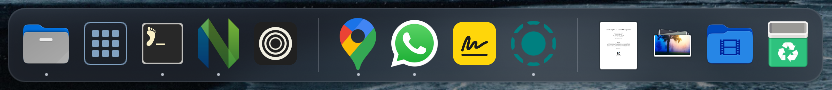

# Vitrin

A macOS-style dock for [Omarchy](https://omarchy.org). Vitrin shows your pinned, running,
and recent apps alongside folder shortcuts like Downloads and Trash. It follows your Omarchy
theme and runs inside the Quickshell session.



## Install

Requires Omarchy 4 on Hyprland. Vitrin was developed on Omarchy 4.0.6 and 4.5 with
Quickshell 0.3.2.

```bash
omarchy plugin add https://github.com/irenkuyucu/vitrin.git --enable
```

Or open the Omarchy menu, go to Setup > Plugins > Add Plugin, and paste the URL.

Omarchy 4.5 and later have a dock of their own, which shows up on floating workspaces and
would overlap Vitrin there. When both are on, Vitrin asks which one to keep. To switch later,
open the Omarchy menu, go to Setup > Plugins, disable the dock you're using, then enable the
other.

Plugins run inside the Omarchy shell with your permissions, so it's worth reading the code
of any plugin before you enable it. To remove Vitrin:

```bash
omarchy plugin remove vitrin
```

## Using the dock

- **Apps**: Click an app icon on the dock to open it, switch to it, or cycle through its
  open windows. Middle-click opens a new window; right-click lists its windows and options.
  You can pin apps to keep them in the dock, and drag icons to reorder them, or drag one up
  and out of the dock to remove it. Apps you haven't pinned sit in their own section: the
  ones that are running, plus the last three you closed. Drag one among your pinned apps to
  keep it.
- **App launcher**: Click the Apps icon to see all your apps on one screen, and start typing
  to find one. Omarchy's Apps shortcut (Super+Alt+Space) opens it too. If you don't need the
  icon, drag it out of the dock; you can bring it back in Dock Settings.
- **Folders**: Folder shortcuts sit on the right side of the dock. Click one to browse its
  newest files in a stack, or middle-click it to open it in your file manager; the Trash
  always opens there. To add a shortcut, drag a folder onto the dock between the folders.
  You can drag shortcuts to reorder them, or up and out of the dock to remove them.
  Right-click a folder for its options.
- **Dividers**: Right-click a divider to turn hiding on or off, or to open Dock Settings.
  Drag a divider up or down to resize the dock.
- **Dropping files and folders**: Drop files or folders on an app to open them with it, or
  on a folder (including Trash) to move them there. Anything on another drive is copied to
  the folder instead of being moved. Hold a drag over an open app's icon for a second to
  bring its window to the front.

## Settings and configuration

Most settings are in Dock Settings (right-click a divider). They're saved in
`~/.config/omarchy/vitrin.json`, which you can also edit by hand; the dock picks up the
changes when you save the file.

| Setting | Default | What it does |
|---|---|---|
| `iconSize` | `52` | Icon size in pixels, 32 to 72 |
| `autoHide` | `true` | Hide the dock until the pointer reaches the bottom edge |
| `hideDelay` | `500` | Milliseconds before it hides, 0 to 2000 |
| `showRecent` | `true` | Show running and recent apps in their own section |
| `showApps` | `true` | Show the app launcher's icon in the dock |
| `dividerResize` | `true` | Resize the dock by dragging a divider |
| `animateLaunch` | `true` | Bounce an icon while its app starts |

`pins` lists your pinned apps by desktop entry ID, in order. `folders` lists your folder
shortcuts, in order, with the Trash always last. Each one looks like this:

```json
{ "name": "Projects", "path": "~/Projects", "icon": "folder", "displayAs": "stack" }
```

`displayAs` is `"stack"` to show the folder's newest files on its dock icon, or `"folder"`
to show the folder icon. `icon` is an icon name or a path to an image.

If the file can't be read (after a typo, for example), Vitrin keeps its current settings,
doesn't overwrite your file, and saves a copy of it as `vitrin.json.broken`.

## Look and feel

Vitrin takes its colors from your Omarchy theme and its icons from your icon theme, so it
matches the rest of your desktop and changes along with it when you switch themes.

Blur behind the dock is the one part you set up yourself, since plugins can't change
Hyprland's settings. Add these lines to `~/.config/hypr/looknfeel.lua`. Omarchy makes
windows slightly transparent, so they turn blur on for the dock only:

```lua
hl.config({ decoration = { blur = { enabled = true, size = 8, passes = 2 } } })
o.window(".*", { no_blur = true })
hl.layer_rule({ match = { namespace = "^vitrin$" }, blur = true, ignore_alpha = 0.3 })
```

## Troubleshooting

**The dock doesn't show up.** If you're on Omarchy 4.5 or later and kept Omarchy's own
dock when Vitrin asked, Vitrin turned itself off; see [Install](#install) to switch back.

**An app shows the wrong icon or name.** Some apps' windows don't identify themselves the
way their desktop entry expects. The shell log names the window's ID; add it to `aliases`
in the config file, pointing to the app's desktop entry ID:

```json
"aliases": { "org.localsend.localsend_app": "localsend" }
```

To read the shell log:

```bash
quickshell log -p "$OMARCHY_PATH/shell"
```

## Known limitations

- A future Omarchy update could stop Omarchy's Apps shortcut from opening Vitrin's app
  launcher. The Apps icon on the dock would still work.
- With hiding off, Omarchy's volume and brightness pop-up overlaps the top of the dock.
- In full-screen games, the bottom edge can still bring up the dock, unless the game
  captures the pointer.

## Development

Vitrin is a regular Omarchy plugin: `manifest.json`, the QML files, and helper scripts in
`scripts/`. Restart the shell to load changes:

```bash
omarchy restart shell
```

## License

Vitrin is released under the [MIT License](LICENSE).
